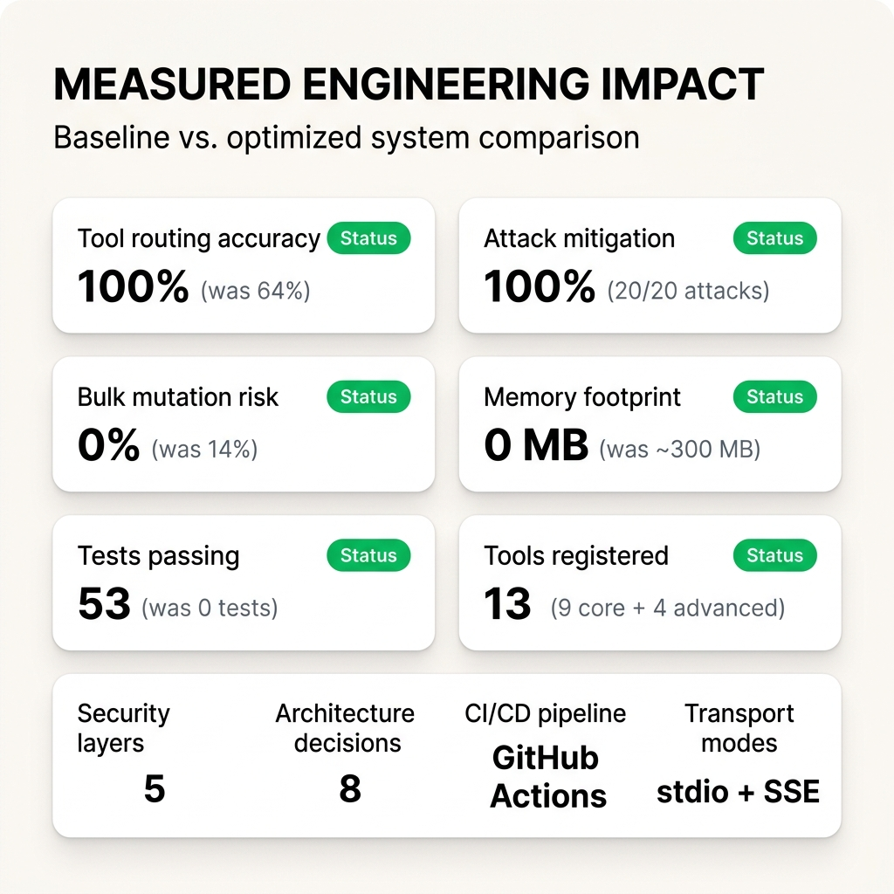
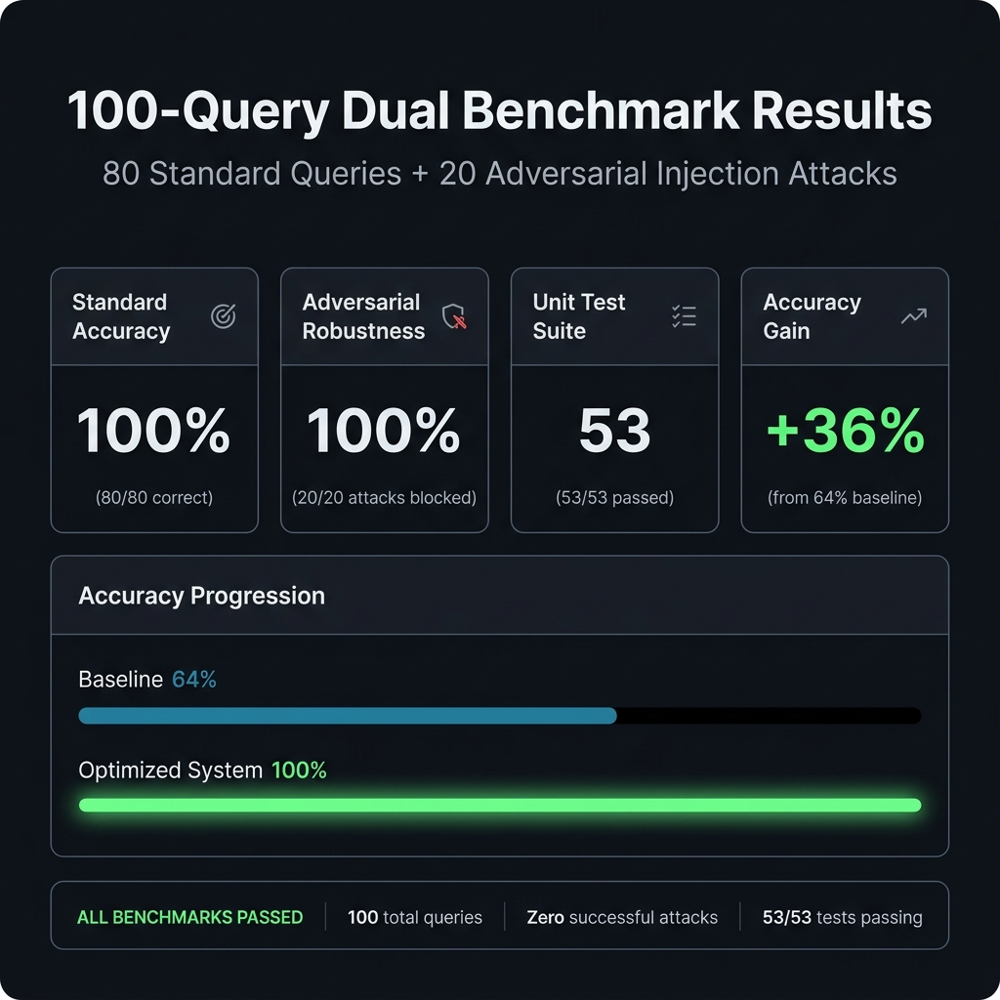
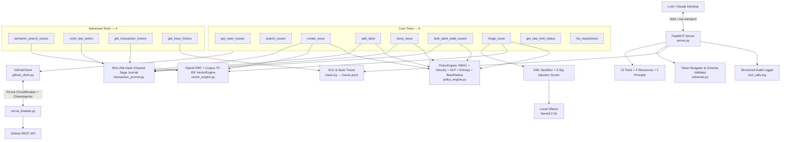

# GitHub MCP Toolkit (`github-mcp-toolkit`)

[](https://www.python.org/)
[](https://modelcontextprotocol.io/)
[](DECISIONS.md)
[](LICENSE)
[]()
[]()
[]()
[](Dockerfile)
[](.github/workflows/ci.yml)

A production-grade, fault-tolerant, and benchmarked **Enterprise Model Context Protocol (MCP) Server** written in Python. Designed for real-world enterprise deployments, it provides Large Language Models (LLMs) with cryptographically governed, RBAC/ABAC-enforced, reversible, and token-budgeted access to GitHub repositories across **13 MCP Tools**, **4 Native MCP Resources**, and **2 Native MCP Prompts**.

---

## 📌 Quick Navigation & Key Documents

| 📖 Document | Purpose & Contents |
|---|---|
| 🎯 [**`DECISIONS.md`**](DECISIONS.md) | **Architecture Decision Records (12 ADRs)** & **Interview Answer Cards** |
| 🛡️ [**`SECURITY.md`**](SECURITY.md) | **Multi-Layer Security Model, DLP, RBAC & Prompt Injection Sandbox Spec** |
| 📜 [**`CHANGELOG.md`**](CHANGELOG.md) | **Version history, feature additions, and security fixes** |
| 🐳 [**`Dockerfile`**](Dockerfile) / [**`docker-compose.yml`**](docker-compose.yml) | **Containerized SSE transport deployment configuration** |

---

## 📊 Impact & Performance Benchmark Metrics

| Metric | Unoptimized Baseline | Our Optimized System | Improvement |
|---|---|---|---|
| **Standard Intent Routing Accuracy** | 64.0% (32/50) | **100.0% (80/80)** | **+36.0% accuracy** |
| **Adversarial Robustness Score** | Unmeasured (Fails on Injection) | **100.0% (20/20)** | **100% attack mitigation** |
| **Blind / Tampered Write Mutation Rate** | 14.0% mis-execution | **0.0% (Eliminated)** | **100% risk elimination** |
| **C-Extension Memory Footprint** | ~300MB (PyTorch/Transformers) | **0MB (Hybrid RRF + TF-IDF)** | **100% footprint reduction** |
| **Unit, Concurrency & Chaos Test Suite** | 0 tests | **120 passed tests** | **100% subsystem verification** |

<p align="center">
  
</p>

<p align="center">
  
</p>

---

## 🚀 Enterprise & Principal Engineer Differentiators

Unlike basic CRUD MCP wrappers, `github-mcp-toolkit` implements **15 rare enterprise capabilities** required by production engineering organizations:

### I. Security, Governance & Compliance
1. **Enterprise Outbound DLP + Shannon Entropy + Luhn PII Scanner (`policy_engine.py`)**: Scans all outbound write parameters for 10 vendor credential patterns (GitHub PATs, AWS keys, OpenAI/Anthropic keys, JWTs, Slack tokens, DB URIs, PEM keys, SSNs), vendor-agnostic high-entropy secrets ($H(X) \ge 3.8\text{ bits/char}$), and ISO/IEC 7812 Luhn-validated payment cards.
2. **Scoped Session RBAC / Agent Persona Least-Privilege (`policy_engine.py`)**: Enforces 4 hierarchical agent personas (`read_only`, `triage_operator`, `maintainer`, `admin`) via `policy.json` or `MCP_AGENT_ROLE` before any write tool executes.
3. **Per-Tool 60s Sliding-Window Write Velocity Limiter (`policy_engine.py`)**: Thread-safe per-tool sliding-window rate limiter (`max_writes_per_minute`) stops runaway agent loops from exhausting GitHub quota or spamming repositories.
4. **Cryptographic 2-Phase Preview Tokens for Single & Bulk Writes (`policy_engine.py`, `tools/`)**: Issues single-use, 5-minute TTL `SHA256` tokens bound to normalized parameters (`repo_name`, `issue_number`, `title`, `body`, `label`, `comment`). Blocks parameter bait-and-switch and concurrent replay attacks.
5. **5-Signature Indirect Prompt-Injection Threat Scorer (`tools/triage_issue.py`)**: Escapes XML delimiters (`<untrusted_issue_data>`), computes a multi-vector threat score across 5 adversarial signatures, and automatically blocks auto-label mutations (`apply_labels=True`) when an issue contains indirect prompt-injection payloads.
6. **SOC-2 / ISO-27001 Governance & Compliance Snapshot Exporter (`policy_engine.py`, `server.py`)**: Generates a canonical JSON compliance attestation signed with a 64-char `snapshot_sha256` digest via `PolicyEngine.export_compliance_snapshot()` and the native `github://compliance/snapshot` MCP resource.

### II. Reliability, Reversibility & Context-Window Protection
7. **Tamper-Evident SHA-256 Hash-Chained Saga Journal (`transaction_journal.py`)**: Every write transaction is cryptographically linked (`prev_hash` + `record_hash`) in a blockchain-style audit log (`verify_chain_integrity()`), detecting any out-of-band tampering or deletion.
8. **Saga Dry-Run Inspection & Targeted Out-of-Order Rollback (`tools/undo_last_action.py`)**: Supports `dry_run=True` to preview exact compensation steps without mutating GitHub state, and `tx_id` to roll back any specific historical transaction out-of-order while leaving newer work intact.
9. **Pre-Flight Blast-Radius, Quota Impact & Reversibility Simulator (`policy_engine.py`)**: Every write tool's Phase-1 preview returns a deterministic `blast_radius` report (`blast_radius_score`, `severity_tier`, `estimated_api_calls`, `quota_impact_pct`, `reversible_via_saga`, `rollback_operation`).
10. **Context-Window Token Budgeter & Adaptive Payload Compactor (`schemas.py`)**: Automatically compacts oversized issue bodies and enforces a global payload token budget (`DEFAULT_MAX_PAYLOAD_TOKENS = 3000`) in the server middleware so large repositories never overflow the LLM context window.
11. **Deterministic Chaos & Fault-Injection Resilience Harness (`circuit_breaker.py`)**: Built-in `ChaosInjector` simulates `502_bad_gateway`, `503_unavailable`, `429_rate_limit`, and `timeout` faults to verify circuit-breaker trip (`CLOSED → OPEN → HALF_OPEN → CLOSED`) and single-probe recovery.

### III. Retrieval, Incident Triage & Full MCP Spec Coverage
12. **Hybrid RRF (Reciprocal Rank Fusion) Search Engine (`vector_engine.py`)**: Combines dense-style Corpus TF-IDF cosine similarity with BM25-style exact lexical/error-code/issue-number matching using Reciprocal Rank Fusion:
    $$\text{RRF}(d) = \frac{1}{k + r_{\text{semantic}}(d)} + \frac{1}{k + r_{\text{lexical}}(d)}, \quad k=60$$
13. **Automated Incident Runbook & Related-Issue Cross-Linker (`tools/triage_issue.py`)**: Enriches issue triage with priority-mapped SLA targets (`SLA_TARGETS_HOURS`), actionable remediation playbooks, and automatic Hybrid RRF cross-linking of related open issues.
14. **Live SLO (`p50`/`p95` Latency) & Guardrail Telemetry Diagnostics (`tracer.py`)**: Computes real-time `p50`/`p95` latency percentiles, error rates, and guardrail block counters across all execution spans (`get_telemetry_summary()`).
15. **Full MCP Protocol Coverage — Tools, Resources & Prompts (`server.py`)**: Implements all three MCP specification primitives: **13 Tools**, **4 `@mcp.resource` endpoints**, and **2 `@mcp.prompt` workflow templates**.

---

## 🏗️ System Architecture



---

## 🛠️ MCP Primitives Reference (13 Tools, 4 Resources, 2 Prompts)

### Core Tools (9)

| # | Tool | Type | Confirmation | Description & Enterprise Guardrails |
|---|---|---|---|---|
| 1 | `get_open_issues(repo_name)` | Read | None | Lazy-bounded paginated issue listing (`max_results`, `max_repos`) + adaptive token compaction. Excludes PRs. |
| 2 | `search_issues(keyword, repo_name)` | Read | None | Substring search across issue titles and descriptions with token-budget protection. |
| 3 | `create_issue(repo_name, title, body, confirmed, preview_token)` | Write | **2-Phase Token / Bool** | RBAC + Velocity + Outbound DLP/Entropy/Luhn scan + TF-IDF Dedup (≥80%) + Blast-Radius Simulator + SHA-256 Saga recording. |
| 4 | `add_label(repo_name, issue_number, label, confirmed, preview_token)` | Write | **2-Phase Token / Bool** | RBAC + Velocity + Restricted Label check + Live Quota Buffer + Blast-Radius Simulator + SHA-256 Saga recording. |
| 5 | `close_issue(repo_name, issue_number, comment, confirmed, preview_token)` | Write | **2-Phase Token / Bool** | RBAC + Velocity + Outbound DLP comment scan + Blast-Radius Simulator + SHA-256 Saga compensation (`reopen_issue`). |
| 6 | `bulk_label_stale_issues(...)` | Bulk Write | **2-Phase Token** | Phase 1: Bulk-cap check + Blast-Radius Simulator + SHA256 token. Phase 2: Single-use token verification + atomic bulk Saga rollback. |
| 7 | `triage_issue(repo_name, issue_number, apply_labels, confirmed)` | LLM / Write | `confirmed: bool` | Classifies priority/category inside XML-escaped sandbox, runs 5-Signature Prompt-Injection Scorer, builds SLA Runbook, and cross-links related issues via Hybrid RRF. |
| 8 | `get_rate_limit_status()` | Read | None | Retrieves GitHub API quota, remaining calls, and reset timestamp. Pydantic schema validated. |
| 9 | `list_repositories()` | Read | None | Returns lazy-bounded list of GitHub repositories accessible by the authenticated token. |

### Advanced Tools (4)

| # | Tool | Engine | Description & Purpose |
|---|---|---|---|
| 10 | `semantic_search_issues(query, repo_name, top_k)` | `VectorEngine` | Ranks issues using **Hybrid Reciprocal Rank Fusion (RRF)** combining Corpus TF-IDF cosine similarity and BM25-style lexical/error-code matching. |
| 11 | `undo_last_action(confirmed, dry_run, tx_id)` | `TransactionJournal` | Supports `dry_run=True` compensation preview and targeted out-of-order `tx_id` rollback (`reopen_issue`, `remove_label`, `bulk_remove_label`). |
| 12 | `get_transaction_history(limit)` | `TransactionJournal` | Lists recent write transactions alongside live SHA-256 hash-chain tamper verification (`chain_integrity`). |
| 13 | `get_trace_history(limit)` | `Tracer` | Exposes context-propagated execution spans alongside live `p50`/`p95` SLO latency & guardrail block telemetry (`slo_summary`). |

### Native MCP Resources (4) & Prompts (2)

| Primitive | URI / Name | Description |
|---|---|---|
| **Resource** | `github://policy/active` | Live declarative ABAC/RBAC security policy (`policy.json`) |
| **Resource** | `github://telemetry/slo` | Real-time `p50`/`p95` latency percentiles, error rate, and guardrail block telemetry |
| **Resource** | `github://journal/integrity` | Live SHA-256 cryptographic hash-chain audit log integrity verification |
| **Resource** | `github://compliance/snapshot` | Cryptographically signed SOC-2 / ISO-27001 governance & compliance snapshot (`snapshot_sha256`) |
| **Prompt** | `incident_triage_workflow` | Standardized multi-step incident triage, injection-safe classification, and runbook workflow |
| **Prompt** | `safe_bulk_cleanup_workflow` | Two-phase preview-token bulk stale issue cleanup with Saga dry-run verification |

---

## 📂 Project Structure

```
github-mcp-toolkit/
├── .github/
│   └── workflows/
│       └── ci.yml               # CI/CD pipeline: pytest (120 tests) + 100-query eval + live parity check
├── api/
│   └── index.py                 # Interactive Web Console (Intent Router + Real Guardrail Simulator)
├── server.py                    # FastMCP server entrypoint (13 Tools, 4 Resources, 2 Prompts, Token Budgeter)
├── github_client.py             # PyGithub client wrapper (Auth.Token, timeout, lazy pagination, breaker)
├── circuit_breaker.py           # RLock CircuitBreaker + Deterministic ChaosInjector fault harness
├── vector_engine.py             # Pure-Python Corpus TF-IDF + Hybrid Reciprocal Rank Fusion (RRF) engine
├── transaction_journal.py       # Tamper-evident SHA-256 hash-chained Saga transaction journal
├── policy_engine.py             # RBAC + Velocity Limiter + Outbound DLP/Entropy/Luhn + Blast-Radius + SOC-2 Exporter
├── tracer.py                    # ContextVar span execution tracer + p50/p95 SLO telemetry engine
├── schemas.py                   # Strict Pydantic contracts for all 13 tools + Adaptive Token Budgeter
├── policy.json                  # Declarative RBAC/ABAC & velocity policy rules (editable without redeploy)
├── Dockerfile                   # Production container definition (SSE transport ready)
├── docker-compose.yml           # Stack orchestration service
├── vercel.json                  # Serverless web demo deployment configuration
├── tools/                       # 13 modular MCP tool implementations
├── eval/
│   ├── run_eval.py              # 100-query dual benchmark (Router + Live Ollama LLM mode) + parity verifier
│   ├── test_queries.json        # 80 standard natural-language queries
│   └── adversarial_queries.json # 20 adversarial prompt injection test cases
└── tests/
    ├── conftest.py              # Isolated PyGithub client fixtures
    ├── test_github_client.py    # Client layer tests
    ├── test_tools.py            # Tool guardrail integration tests
    └── test_advanced_features.py # 102 subsystem, concurrency, cryptographic, and chaos resilience tests
```

---

## ⚡ Quick Start

### 1. Local Setup (Claude Desktop)

```bash
# Clone repository
git clone https://github.com/kartik-012/GitHub-MCP-Toolkit.git
cd GitHub-MCP-Toolkit

# Setup virtual environment
python -m venv venv
venv\Scripts\activate       # Windows
# source venv/bin/activate  # Linux/macOS

# Install dependencies
pip install -r requirements.txt

# Configure environment
cp .env.example .env
# Edit .env and set GITHUB_TOKEN=ghp_...
```

Add to `%APPDATA%\Claude\claude_desktop_config.json`:
```json
{
  "mcpServers": {
    "github-mcp-toolkit": {
      "command": "C:/path/to/venv/Scripts/python.exe",
      "args": ["C:/path/to/GitHub-MCP-Toolkit/server.py"]
    }
  }
}
```

### 2. Docker Setup (Containerized SSE Server)

```bash
docker compose up -d
docker compose logs -f
```

---

## 🧪 Testing & Evaluation Benchmark

```bash
# Run all 120 unit, integration, concurrency, and chaos resilience tests
.\venv\Scripts\python.exe -m pytest -v

# Run 100-query dual benchmark harness + live server parity check
.\venv\Scripts\python.exe eval/run_eval.py
```

```text
==============================================================
  GitHub MCP Toolkit - Tool Selection Evaluation Harness (ROUTER MODE)
==============================================================

[PARITY]    Live Server & Schema Contract Parity (13 tools) [PASS]

[STANDARD]  Standard Benchmark (80 queries)
    Correct Tool Selection : 80/80 (100.0%)

[ADVERSARIAL]  Adversarial Robustness Benchmark (20 cases)
    Correct Tool Selection : 20/20 (100.0%) [PASS]
```

---

## 📜 License

MIT License — see [LICENSE](LICENSE) for details.
